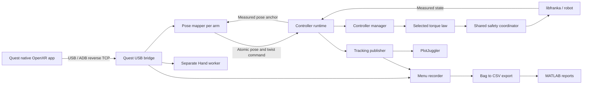

# Teleoperation architecture

The Quest app measures hand motion; ROS maps it into a robot reference; an arm
owner computes seven joint torques and sends them through the safety layer to
libfranka. The Hand and recorder run in separate processes.



## Package responsibilities

| Package | Responsibility | Main launch / config |
| --- | --- | --- |
| `quest_teleop_interfaces` | Shared messages and calibration service | `msg/`, `srv/` |
| `quest_teleop` | C++ USB bridge; Python mapping and configuration validation | `quest_teleop.launch.py`, `config/arms.yaml` |
| `teleop_controllers` | Arm ownership, mode arbitration and joint torque laws | `cartesian_impedance_controller.launch.py`, `config/controllers.yaml` |
| `safety_filter` | Actuator bounds, CBF geometry/QP and coupled coordinator | `safety_filter.launch.py`, `config/safety.yaml` |
| `teleop_gripper` | Hand input decisions and blocking gripper operations | `gripper.launch.py`, `config/gripper.yaml` |
| `recording` | Menu/continuous rosbag recording and tracking CSV export | `recording.launch.py`, `config/recording.yaml` |
| `teleop_bringup` | Composes features using one complete runtime YAML | `teleoperation.launch.py`, `config/single_panda.yaml` or `dual_panda.yaml` |

Legacy `panda_bringup` and `panda_demos` are separate reference packages. Pinned
third-party libraries live in `src/third_party`; do not format or refactor them
as part of changes to the active teleoperation code.

## Arm runtime and controller structure

| File in `teleop_controllers` | Owns |
| --- | --- |
| `src/controller_runtime.cpp` | ROS parameters/subscriptions, command handoff, backend adapters, permanent FCI ownership, shared safety and non-realtime telemetry |
| `src/controller_manager.cpp` | Freshness/session/order gates, arming, state validation, reference capture and selection of one nominal torque law |
| `include/teleop_controllers/torque_controller.hpp` | Common fixed-size state/reference to seven-joint nominal torque interface |
| `src/cartesian_impedance_controller.cpp` | Cartesian filtered-error impedance law |
| `src/position_hold_controller.cpp` | Joint PD holding with stiffness ramp |
| `src/damping_controller.cpp` | Cartesian damping plus Coriolis for faults and shutdown |
| `src/homing_controller.cpp` | Guarded home gesture, trajectory/controlled-stop state and joint torque law |
| `src/joint_motion_generator.cpp` | Synchronized homing joint references |
| `include/teleop_controllers/control_types.hpp` | Transport-neutral commands, state and statuses |
| `include/teleop_controllers/tracking.hpp` | Fixed-size monitoring snapshots |

The executable retains the name `cartesian_impedance_controller`; it contains
the whole runtime, not just the Cartesian equation. Each arm has one permanent
libfranka owner. Homing and position holding select another law inside that
owner and do not open another arm connection.

The manager chooses homing while active, Cartesian control while engaged,
joint holding after normal trigger release, or damping after faults/shutdown.
Hold entry captures all seven measured joints once; subsequent release samples
do not move the target. Startup also captures the initial configuration.
`motion_enabled=false` means Quest teleoperation is disengaged; joint holding
can still produce restoring torque. Re-engagement captures fresh mapping
anchors. See [runtime behavior](TELEOPERATION_RUNTIME.md).

The Cartesian law uses measured pose error `e`, measured Jacobian `J` and mapped
reference twist `v_ref`:

```text
r = J*dq - v_ref + lambda .* e
tau_nominal = -transpose(J) * (gain .* r) + coriolis
```

`.*` denotes componentwise Cartesian multiplication before the Jacobian
transpose maps the wrench to joints. Gains are fixed at startup. Gravity follows
libfranka's torque-interface convention; the law adds no extra gravity term.

All laws return nominal torque before actuator clipping. The runtime sends it
to one shared safety coordinator and accepts only the matching current-cycle
result. Both CBF-enabled QP constraints and CBF-disabled clipping enforce the
same effective magnitude/rate bounds, anchored to incoming `tau_J_d`.
`cbf.torque_limit_scale` and `cbf.torque_rate_limit_scale` default to 0.35;
absolute controller caps can tighten them. In dual mode the stricter configured
arm cap applies to both. Joint holding counts as parked for dual objective
weighting while still passing through every enabled constraint.

The coordinator runs on another thread, but the owner waits for its result on
each cycle. Asynchronous result reuse is still a
[planned extension](MILESTONE_2.md), not current runtime behavior.

## Add another controller design

Implement `TorqueController` in a separate source/header. Its `compute()` takes
`ArmState`, a typed `CartesianReference` or `JointReference`, and the callback
period, and returns `NominalTorque` with seven torques and a fault status.
Use `reset()` to initialize controller state from measured state. Neither
method may allocate, block, perform I/O or call ROS in realtime.

Construct the design in the runtime before control starts and inject it into
`ControllerManager` in place of the baseline Cartesian law. Register its source
in CMake and add parameter validation and focused tests. A new command type
also needs a validated reference adapter. Ownership, homing arbitration, release
holding, fault behavior, safety and monitoring remain shared. Dynamic plugin
loading and live design switching are not implemented.

## Hand, monitoring and recording

The Hand worker owns only the gripper connection. Blocking calibration, grasp
and open calls execute outside the torque thread. Enabling Hand requests one
empty-hand startup calibration. The manual calibration service remains available.
The first deliberate grip after calibration opens; later presses alternate
grasp/open. See the [Hand guide](TELEOPERATION_RUNTIME.md#diagnosing-a-slipping-cable-grasp).

The torque thread copies fixed-size snapshots to a bounded queue. A dedicated
non-realtime thread publishes full-cycle `tracking_samples`; `tracking_status`
provides the latest live view at up to 100 Hz. Overflow drops monitoring samples
with a counter. PlotJuggler consumes the live view; the recorder captures the
full stream; `recording export_tracking` creates CSVs for MATLAB. Clock, validity
and torque conventions are in [trajectory monitoring](TRAJECTORY_MONITORING.md).

## Configuration and launch entry points

Combined bringup accepts exactly `runtime_config` (required path) and
`operator_confirm` (default false, required true for hardware). Everything else
comes from the selected runtime YAML. Package-local configs apply only to
standalone launches. Inspect the backend before launching an edited file.

Standalone feature launches include `quest_usb_bridge.launch.py`,
`pose_mapper.launch.py`, `homing.launch.py`, `gripper.launch.py` and
`recording.launch.py`. `safety_filter.launch.py` includes parameters for the arm
owner; it does not start an independent robot process.
`teleop_bringup robot_free.launch.py` starts mapping and optional recording
without an arm or Hand owner. It has its own launch arguments and supports an
explicit synthetic measured-pose publisher. Never run that publisher beside
an arm owner on the same measured-pose topic.

Use the [main README](../README.md) for setup/launch, the
[development guide](DEVELOPMENT.md) for builds/tests and the
[implementation record](IMPLEMENTATION_PROGRESS.md) for verification limits.
